# 개발 문서: Document Vocabulary Flashcards

Java 2026-2 개인 프로젝트 · Development documentation · Version 1.0.0 (2026-11-18)

| Section | Evaluation item (weight) |
|---------|--------------------------|
| 1 Project overview, 3 User scenarios | Problem, user, scenario (15%) |
| 2 Requirements | Requirements and acceptance criteria (20%) |
| 4 System architecture, 5 Implementation | Program design (20%) |
| 7 Peer review and change history | Change history (15%) |
| 6 Testing, 7.3 Problems discovered | Testing and improvements (20%) |
| 8 Execution guide | Execution and usage instructions (10%) |

---

## 1. Project overview (프로젝트 개요)

| | |
|---|---|
| **Project name** | Document Vocabulary Flashcards |
| **Type** | Java 25 / Spring Boot web application, also packaged as a macOS desktop app |
| **Target user** | An international student taking lectures in Korean |
| **Source code** | `https://github.com/yusufjonc07/flashcard-app` |

### 1.1 Problem being solved

International students hear and read many unfamiliar Korean academic terms in every lecture
(전송계층, 혼잡 제어, 구현…). Today they copy these terms into messy notes by hand. Then they
have to look up every meaning one at a time. When the exam comes, they cannot tell which terms
they already know and which ones they keep forgetting, so they study everything equally.

### 1.2 Target users

* **Primary:** a foreign student at a Korean university whose lecture slides are in Korean
  (PDF or PowerPoint, sometimes a photo of the board).
* **Assumptions:** the student reads Hangul but not every academic word, studies one lecture
  at a time, and uses a laptop (macOS or any OS with Java 25).

### 1.3 Project objectives

1. Collect vocabulary **directly from the lecture material** instead of typing it.
2. Provide a meaning for every word **automatically**, while still letting the user correct it.
3. Study with flashcards that **show the words the student gets wrong first**.
4. **Never lose progress:** every answer is saved immediately and restored on the next start.

---

## 2. Requirements (요구사항)

### 2.1 Functional requirements

Priority: **M** = must (core of the W09 proposal), **S** = should, **C** = could (added later).

| No. | Requirement | Priority | Input | Expected output | Where |
|-----|-------------|----------|-------|-----------------|-------|
| R1 | Add a Korean term to a vocabulary set | M | Click **Save** in the reader, type a word, or upload CSV/TXT | Word appears in the set's word list | Reader, Words page, Import |
| R2 | Store a meaning for each term | M | Nothing (auto-translated) or a typed meaning | Meaning stored with the word; editable | `FlashcardService.translateAll`, Edit meaning |
| R3 | Unique ID, term and meaning for each item | M | — | Row in `cards` with `id`, `front`, `translation` | `FlashcardRepository` |
| R4 | View all saved words in a numbered list | S | Open Words page | Numbered table with status and ✓/✗ counts | `words.html` |
| R5 | Search by Korean term (or meaning) | S | Search text | Only matching rows | `FlashcardService.searchCards` |
| R6 | Generate flashcards from saved words | M | Press **Learn** | A session with every unmastered word | `FlashcardService.startReview` |
| R7 | Reveal the meaning after trying to recall it | M | Typed answer, or **Show answer** | Correct meaning shown | `ReviewSession.submit / grade` |
| R8 | Record whether each answer was correct | M | Answer | `correct`, `incorrect`, `streak` updated | `Card.answered` |
| R9 | Show frequently missed words first | M | — | Order: most mistakes → shortest streak → oldest | `FlashcardRepository.reviewCards` |
| R10 | Keep words and statistics between runs | M | Close and reopen | Same words and progress | SQLite `flashcards.db` |
| R11 | Open lecture PDF/PPT/PPTX/images and list their Korean words | C | Upload a document | Page images with clickable words | Reader |
| R12 | Show which words on a page are already saved | C (peer review) | Change page | Green **Saved** buttons, "n saved" | Reader |
| R13 | Undo the last answer, edit a meaning, shuffle | C | Undo / pencil / shuffle buttons | Previous state restored / meaning changed | Learn page |
| R14 | Run as a desktop application | C | Double-click `Flashcards.app` | Native window, no browser or JDK needed | `desktop.DesktopApp` |

### 2.2 Non-functional requirements

| No. | Requirement | How it is met |
|-----|-------------|---------------|
| N1 | **Reliability:** no progress is lost on crash or force-quit | Each answer is written to SQLite **before** the session moves on; every change is one SQL statement or one transaction |
| N2 | **Data integrity:** a word is never saved twice in one set | `UNIQUE(document_id, front)` in the database |
| N3 | **Korean text** is stored and shown unchanged | UTF-8 everywhere; test "Korean text, quotes and tabs round-trip" |
| N4 | **Privacy:** documents stay on the computer | Only single words are sent to the translation service; files and progress stay in local `data/` |
| N5 | **Cost:** no paid API or API key | Free MyMemory API; every translation is kept in the `translations` table, so a word is sent once and a page is never translated twice |
| N6 | **Testability:** tests run offline and fast | `Translator` is an interface; tests use a fake dictionary and a temporary database (18 tests in ~4 s) |
| N7 | **Usability:** keyboard first | ←/→ pages, ↑/↓ words, Enter save/answer, H hint, S speak, E edit, Z undo |
| N8 | **Portability:** runs on any OS with Java 25 | Gradle wrapper; the desktop package is built per OS with `jpackage` |

### 2.3 Acceptance criteria (완료 기준)

Each criterion is an automated test in `AcceptanceTest` (see §6).

**AC1: correct answer (normal case)**
* *Starting state:* "학교" (school) is unmastered with 2 consecutive correct answers.
* *Action:* the user types `School` and presses Enter.
* *Expected:* accepted (case-insensitive); "학교" becomes **Mastered**, leaves the review
  queue, and the next word is shown.

**AC2: incorrect or blank answer (failure case)**
* *Starting state:* "사과" (apple) is shown.
* *Action:* the user types `banana`, or leaves the field blank, and presses Enter.
* *Expected:* the correct answer "apple" is shown and "사과" becomes **High priority**. It comes
  back later in the same session and is first in the next session.

**AC3: saving and restoring (normal case)**
* *Starting state:* 5 words were mastered in this session.
* *Action:* the user stops the program and starts it again.
* *Expected:* the 5 words are still **Mastered** and are not in the review queue.

---

## 3. User scenarios (사용자 시나리오)

### Scenario A: collecting words from this week's slides

| Step | User action | Expected behaviour |
|------|-------------|--------------------|
| 1 | Opens the app; the home page lists every set with its progress | 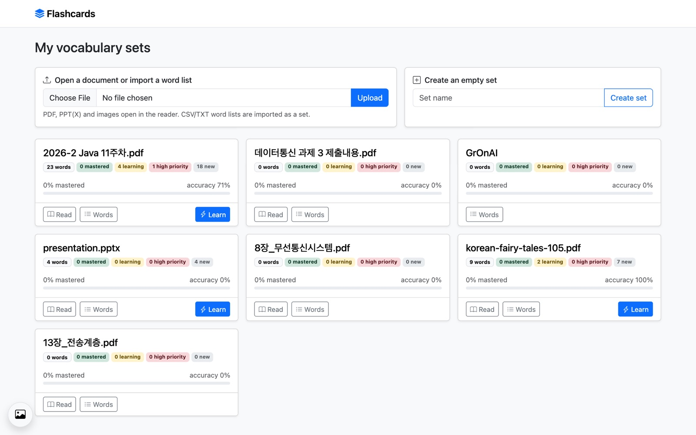 |
| 2 | Uploads `13장_전송계층.pdf` | The file is copied to `data/uploads/`, read once and cached; the reader opens on page 1 |
| 3 | Goes to page 5 | Korean words are underlined on the slide; the list on the right fills with meanings from MyMemory (blurred until hovered, so the student can try to recall first) |
| 4 | Hovers 혼잡 and presses **Save** | The word is saved with its meaning; the button turns green **Saved** |
| 5 | Moves to the next slides | Words saved on earlier slides are already marked **Saved** (peer review change) |

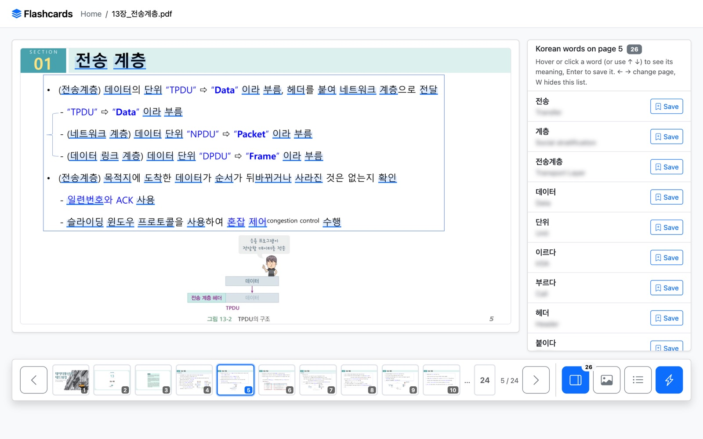

### Scenario B: studying (AC1, AC2)

| Step | User action | Expected behaviour |
|------|-------------|--------------------|
| 1 | Presses **Learn** | The weakest word comes first (here 구현, missed 3 times) |
| 2 | Types `banana`, Enter | "Not quite", correct meaning shown, word marked High priority and moved to the back of the queue |
| 3 | Enter (Next) … later types `IMPLEMENTATION` | "Correct!": matching ignores case; streak becomes 1 → Learning (1/3) |
| 4 | Answers correctly two more times in later sessions | The word becomes **Mastered** and stops appearing |

| Question | Wrong answer (AC2) | Correct answer (AC1) |
|---|---|---|
| 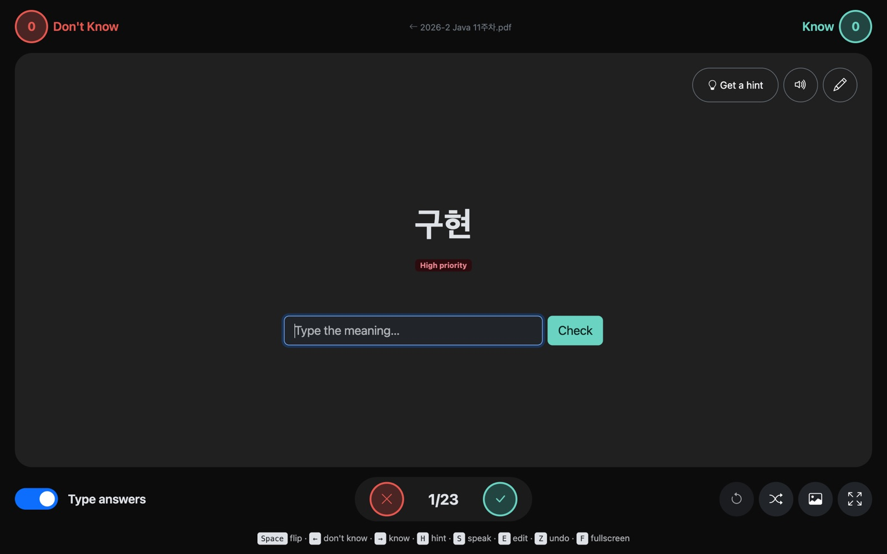 | 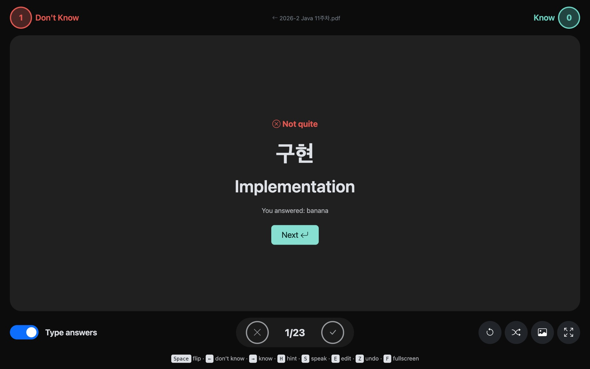 | 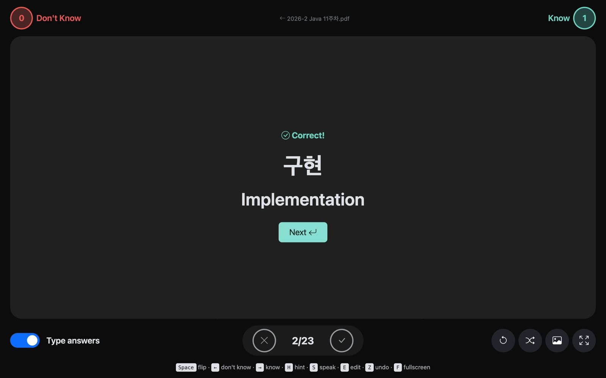 |

### Scenario C: closing and coming back (AC3)

The student closes the window in the middle of a session. Every answer was already saved, so
the next day the home page shows the same counts and the session continues from the weakest
word.

---

## 4. System architecture (시스템 구조)

### 4.1 Layers

```
 Browser / desktop window (Thymeleaf HTML + a little JavaScript)
        │ HTTP (forms, JSON)
 ┌──────▼─────────────────────────────────────────────────────────┐
 │ web        SetController  ReaderController  ReaderApiController │  turns requests into
 │            LearnController  ErrorHandling                       │  service calls
 ├────────────────────────────────────────────────────────────────┤
 │ service    FlashcardService (all application logic)            │
 │            DocumentCache → DocumentReader → PDF/PPT/OCR,        │
 │            KoreanWordExtractor   Translator ← MyMemoryTranslator│
 │            CardImporter                                        │
 ├────────────────────────────────────────────────────────────────┤
 │ model      Card (mastery rule)  ReviewSession  DocumentSet      │  no Spring, no SQL
 ├────────────────────────────────────────────────────────────────┤
 │ repository FlashcardRepository (JdbcTemplate) → data/flashcards.db (SQLite)
 └────────────────────────────────────────────────────────────────┘
 desktop     DesktopMain → DesktopApp: starts the same Spring app and shows it in a JavaFX WebView
```

**Rules:** controllers call only `FlashcardService` and `DocumentCache`; only
`FlashcardRepository` contains SQL; the `model` package has no framework code, so the most
important rules are plain Java and easy to test.

### 4.2 Class diagram

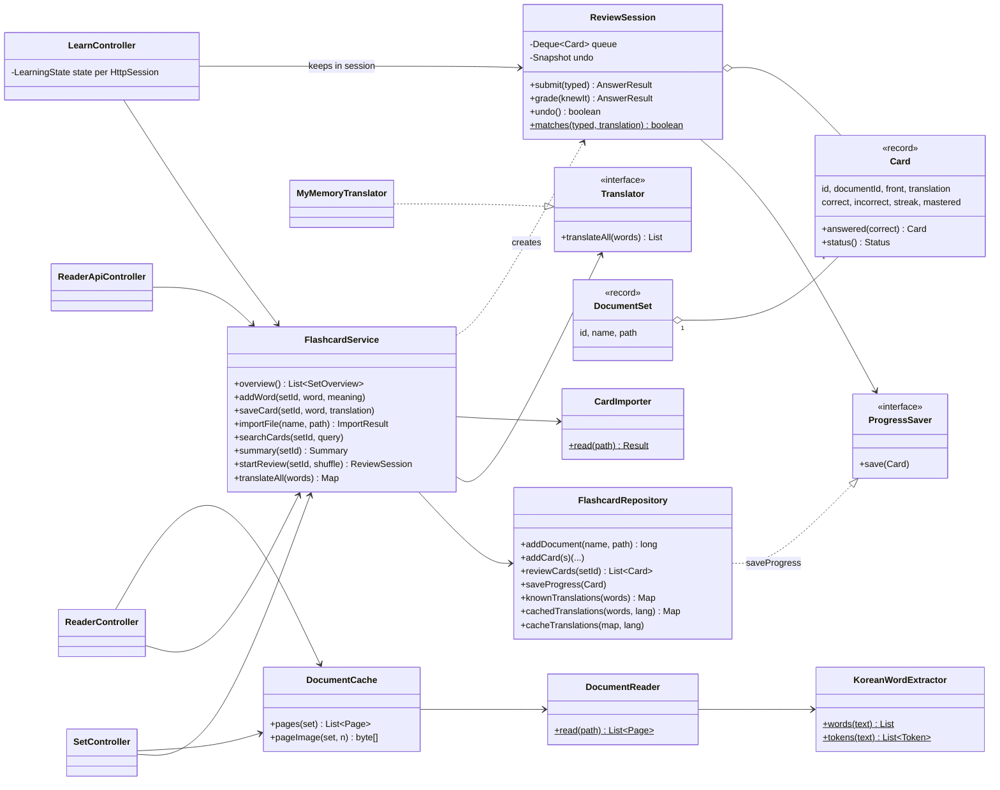

### 4.3 Responsibilities of each class

| Package | Class | Responsibility | Req. |
|---------|-------|----------------|------|
| model | `Card` (record) | One word and its progress. **Owns the mastery rule** (`answered()`: 3 correct in a row) and the status (New / High priority / Learning / Mastered). Immutable: `answered()` returns a new card. | R3, R8 |
| model | `ReviewSession` | One study session: queue of unmastered cards, answer checking (`matches`), re-queueing wrong cards, counters, one-step undo. Saves through `ProgressSaver` **before** changing its queue. | R6–R9, R13 |
| model | `DocumentSet` (record) | A named group of cards from a document, an imported list, or created empty (`manual:` path). | R1 |
| repository | `FlashcardRepository` | The only class with SQL. Creates and migrates the schema, saves sets/cards/progress, review order, finds already-known translations and keeps every fetched translation. | R3, R9, R10 |
| service | `FlashcardService` | Application logic used by every controller: sets, words, import, summaries, starting sessions, translating each word only once (card meaning → saved translation → MyMemory). | all |
| service | `DocumentCache` | Keeps the last 4 parsed documents in memory (LRU), because reading and rendering a PDF is slow. | R11 |
| service | `DocumentReader` + `PDFExtractor`, `PPTExtractor`, `OCRExtractor` | PDF/PPT(X)/image → pages with image, text, words and word positions. PDF pages rendered at 120 DPI. | R11 |
| service | `KoreanWordExtractor` | Splits Korean text with open-korean-text, keeps only content words (nouns, verbs, adjectives, adverbs) in dictionary form, drops particles and stop words. | R11 |
| service | `Translator` / `MyMemoryTranslator` | Korean → English (or another language) with 4 parallel requests and 3 attempts each. | R2 |
| service | `CardImporter` | Parses CSV (`front,back`, header, quotes) and TXT (`word<TAB>meaning`, `word - meaning`, …). | R1, R2 |
| web | `SetController` | Home page, upload (documents and word lists), create set, words page (list, search, add, delete). | R1, R4, R5 |
| web | `ReaderController` / `ReaderApiController` | Reader page and page images; JSON for page translations and saving a word. | R1, R2, R11, R12 |
| web | `LearnController` | Learn page; keeps one `ReviewSession` per browser session; answer, reveal, grade, edit, undo, restart. | R6–R8, R13 |
| web | `ErrorHandling` | Turns exceptions into a red message on the same page, a 404 page, or `{"error": …}` for JSON. | — |
| desktop | `DesktopApp`, `DesktopMain` | Starts Spring on `127.0.0.1`, shows it in a native window, stores data in the user's Application Support folder. | R14 |
| — | `AppPaths` | Where `data/` and `tessdata/` are (overridable for the desktop app). | R10 |

**Who may change state?**
* Card progress is *computed* only by `Card.answered()`, *triggered* only by `ReviewSession`,
  and *written* only by `FlashcardRepository.saveProgress()`.
* The session queue is changed only by `ReviewSession`.
* Sets and words are changed only through `FlashcardService` → `FlashcardRepository`.
* Pages and JavaScript never change data directly; they send a request.

### 4.4 Data storage

`data/flashcards.db` (SQLite through JDBC, one connection because SQLite allows one writer):

```sql
documents(id INTEGER PK, name TEXT, path TEXT UNIQUE, created_at)        -- one row per set
cards(id INTEGER PK, document_id → documents.id, front TEXT, translation TEXT,
      correct INT, incorrect INT, streak INT, mastered INT, created_at,
      UNIQUE(document_id, front))                                         -- once per set
translations(word TEXT, language TEXT, translation TEXT, created_at,
      PRIMARY KEY(word, language))                                        -- every fetched translation
```

* A document set is keyed by the file's absolute path, so opening the same PDF again reuses
  its set. Empty sets use `manual:<name>`.
* `translations` remembers every result from MyMemory, per target language, so opening a page
  again (even after a restart) makes no requests. Failed or blank results are not stored, so
  those words are tried again next time.
* Older databases (from the W11 version) are migrated automatically on start.
* Uploaded files are kept in `data/uploads/` so the reader can open them again.

### 4.5 Data flow and execution flow

**Program start:** `FlashcardApplication.main` creates `data/` → Spring creates the beans →
`FlashcardRepository` creates/migrates the tables → Tomcat listens on port 8080 (desktop app:
`127.0.0.1:18080`, and the window loads the home page).

**Reading a document and saving a word (R1, R2, R11, R12):**

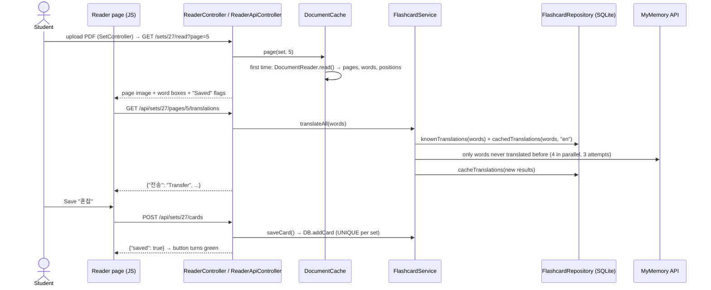

**Answering a flashcard (R6–R10, AC1–AC3):**

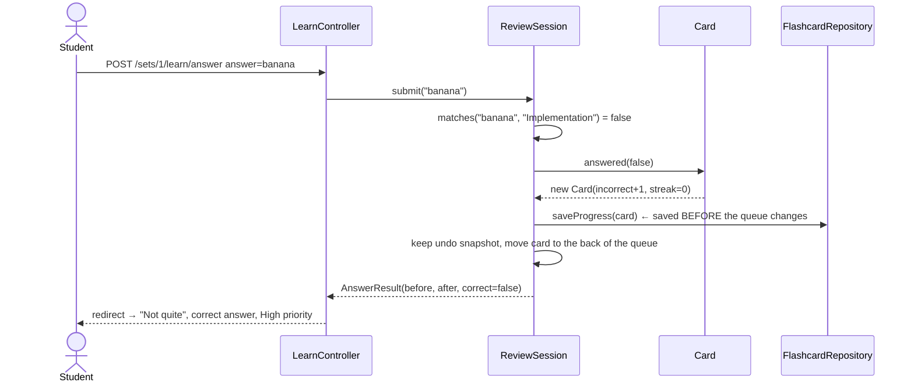

If `saveProgress` throws (for example the disk is full), the exception leaves `submit()`
before the queue or counters change, so the session and the database still agree, and the
user sees an error and can try again.

---

## 5. Implementation (구현)

### 5.1 Main features

| Page | Features |
|------|----------|
| Home | Every set with word count, mastered / high-priority / learning / new counts, accuracy, mastery bar; one upload form for documents and word lists; **New set** |
| Reader | Page image (two portrait pages side by side); underlined Korean words (PDF) with the meaning on hover; word list with **Save** (toggle with W); **Saved** marks; up to 10 thumbnails; keys ←/→, ↑/↓, Enter |
| Learn | Typed answers or **Know / Don't know**; Hint (H), Pronounce (S), Edit meaning (E), Undo (Z), Shuffle, Fullscreen; summary at the end with **Start again** |
| Words | Numbered list with status and ✓/✗ counts; search by word or meaning; add a word (blank meaning = translate); delete |
| Desktop | `Flashcards.app` / `.dmg` with its own Java runtime and the OCR data inside |

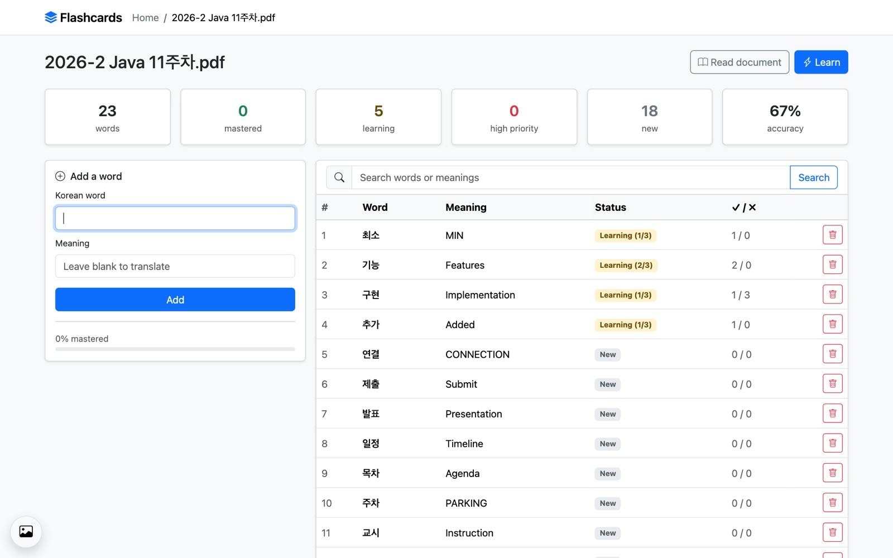

### 5.2 Important methods

| Method | Why it matters |
|--------|----------------|
| `Card.answered(boolean)` | The single place of the mastery rule: correct → `streak+1`, mastered at 3; wrong → `incorrect+1`, `streak=0`, not mastered. |
| `ReviewSession.matches(typed, translation)` | Lower-cases, collapses spaces, strips surrounding punctuation and a leading "a/an/the/to"; accepts any alternative in "professor, teacher"; blank is never correct. |
| `ReviewSession.apply(card, correct, given)` | Save first, then snapshot for undo, then change the queue (wrong cards go to the back). |
| `FlashcardRepository.reviewCards(setId)` | `WHERE mastered = 0 ORDER BY incorrect DESC, streak ASC, id ASC`: implements R9. |
| `FlashcardService.translateAll(words)` | Uses a card's meaning first, then a translation fetched earlier, and sends only never-seen words to MyMemory; new results are stored, so a page is translated once. |
| `KoreanWordExtractor.tokens(text)` | Returns each word with its position, so the reader can draw one box per word even when a slide line has no spaces (질의응답및발표자전환). |
| `DesktopApp.start(stage)` | Starts Spring in a background thread, shows a spinner, then loads the page; handles JavaScript `confirm()` with a native dialog. |

### 5.3 Libraries used

| Library | Version | Used for |
|---------|---------|----------|
| Spring Boot (Web MVC, Thymeleaf, JDBC) | 4.1.1 | Web server, HTML templates, database access |
| sqlite-jdbc | 3.53.4.0 | Local database |
| Apache PDFBox | 3.0.8 | PDF text, word positions, page images |
| Apache POI | 5.4.1 | PPT and PPTX text |
| Tess4J (+ Tesseract) | 5.20.0 | OCR of images (Korean + English) |
| open-korean-text | 2.3.1 | Korean tokenising and part-of-speech tags |
| Gson | 2.14.0 | Reading MyMemory JSON |
| Bootstrap / Bootstrap Icons (WebJars) | 5.3.3 / 1.11.3 | Page layout, served offline |
| OpenJFX (javafx-web) | 25.0.1 | Desktop window |
| JUnit 5, Spring Test | from Spring Boot | Automated tests |

---

## 6. Testing (테스트)

### 6.1 Test environment

* macOS 26 (Apple Silicon), Temurin JDK 25.0.4, Gradle 9.5.1 (wrapper).
* `./gradlew test`: each test gets a **new temporary SQLite file** and a **fake translator**
  (a small dictionary), so tests are repeatable and need no network.
* **Clean-environment check (2026-11-18):** the repository files were copied to an empty
  folder and run with an **empty Gradle cache**. Gradle and every library were downloaded
  from scratch, and all 18 tests passed in 59 s.

### 6.2 Automated test cases

| # | Test (condition) | Expected result | Actual |
|---|------------------|-----------------|--------|
| T1 | **AC1:** 학교 has streak 2; type `School` | Accepted, Mastered, leaves queue, next word shown | Pass |
| T2 | **AC1:** `School`, `  school. `, `academy` for "school, academy", `study` for "to study"; `banana`, blank, null | First four accepted; last three rejected | Pass |
| T3 | **AC2:** 사과 shown; type `banana` | Correct answer "apple" shown; High priority; comes back after other words; first next session | Pass |
| T4 | **AC2:** blank answer | Counts as incorrect | Pass |
| T5 | **AC3:** 6 words; 5 answered right 3 sessions in a row, 교수 always wrong; then new objects open the same database file ("restart") | 5 words still Mastered; review queue is only 교수 | Pass |
| T6 | Review order with mixed mistakes/streaks | Most mistakes → shortest streak → oldest | Pass |
| T7 | Answer, then **Undo** | Database row and queue back to the earlier state | Pass |
| T8 | Saver throws during an answer | Same current card, counters unchanged | Pass |
| T9 | CSV with BOM + header, quoted `"professor, teacher"`, blank line, comment, duplicate, missing meaning; then the same file again | 3 added, missing meaning translated; second import adds 0 and skips 3 | Pass |
| T10 | TXT lines `학교⇥school`, `사과 - apple`, `시험,exam`, `도서관`, blank, `# note` | 3 cards parsed; 도서관 listed as needing translation | Pass |
| T11 | Same word in two sets; twice in one set | Allowed in two sets; second insert in the same set refused | Pass |
| T12 | Korean text with quotes and tabs | Read back unchanged | Pass |
| T13 | **Peer review 1:** translate 학교 (already saved), 사과, 사과; add 도서관 with blank meaning; then translate the same page twice and once more after a restart | Saved meaning reused; translator called once only for 사과; 도서관 saved as "library"; second view sends only the untranslatable word; nothing sent after restart | Pass |
| T14 | Manual set: add, duplicate, untranslatable word, search, summary, delete | Each behaves as specified; untranslatable word gives a clear error | Pass |
| T15 | Web: `GET /` | Home page lists the sets | Pass |
| T16 | Web: `POST /sets/{id}/words` with blank meaning | Word saved as "apple"; shown on Words page | Pass |
| T17 | Web: learn page, `banana` then `Apple` | Wrong → High priority; right → correct 1, streak 1 | Pass |
| T18 | Web: `GET /sets/999999` | 404 page | Pass |

```
$ ./gradlew test
AcceptanceTest > AC1: the 3rd consecutive correct typed answer masters the word PASSED
AcceptanceTest > AC1: answers match ignoring case, spaces, punctuation and listed alternatives PASSED
AcceptanceTest > AC2: a wrong answer shows the meaning, marks high priority and comes back PASSED
AcceptanceTest > AC2: a blank answer counts as incorrect PASSED
AcceptanceTest > AC3: mastered words stay mastered after restarting the program PASSED
...                                                   (14 AcceptanceTest + 4 WebFlowTest)
BUILD SUCCESSFUL — 18 tests, 0 failures
```

### 6.3 Manual tests in the running app

| # | Condition | Expected | Actual |
|---|-----------|----------|--------|
| M1 | Upload `13장_전송계층.pdf`, open page 5 | Korean words underlined; meanings appear in the list | 26 words found and translated (screenshot §3) |
| M2 | `korean-fairy-tales-105.pdf`, pages 5–6 after saving words earlier | Earlier words marked **Saved**, header "n saved" | "2 saved" shown (screenshot below) |
| M3 | Learn: type `banana` for 구현 | "Not quite", meaning "Implementation", High priority | As expected (screenshot §3) |
| M4 | Learn: type `IMPLEMENTATION` | Accepted (case-insensitive) | "Correct!", Learning (1/3) |
| M5 | Words page: search `학` | Only words containing 학 | As expected |
| M6 | Close the app during a session, start again | Same counts on the home page | As expected |
| M7 | Double-click `Flashcards.app` (desktop build) | Native window opens on the home page | As expected (screenshot below) |
| M8 | Open page 3 of `13장_전송계층.pdf` (a scanned slide) | Words listed | **No words found:** see problem P4 |
| M9 | Open page 9 of `13장_전송계층.pdf` twice, restart, open it again | Second and later views make no translation requests | 19 words; 3.4 s first, 0.003 s second, 0.012 s after restart |

| Saved words on later pages (peer review 2) | Desktop app |
|---|---|
| 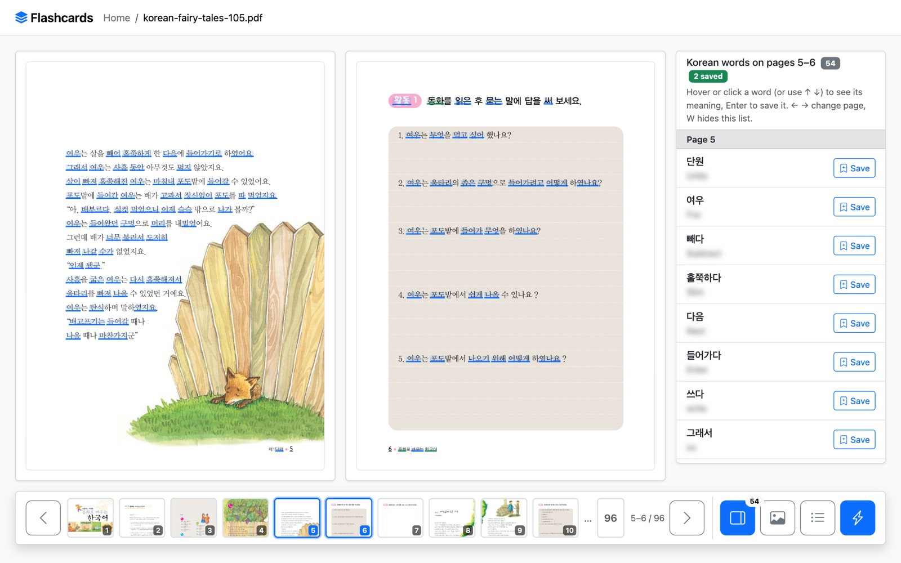 | 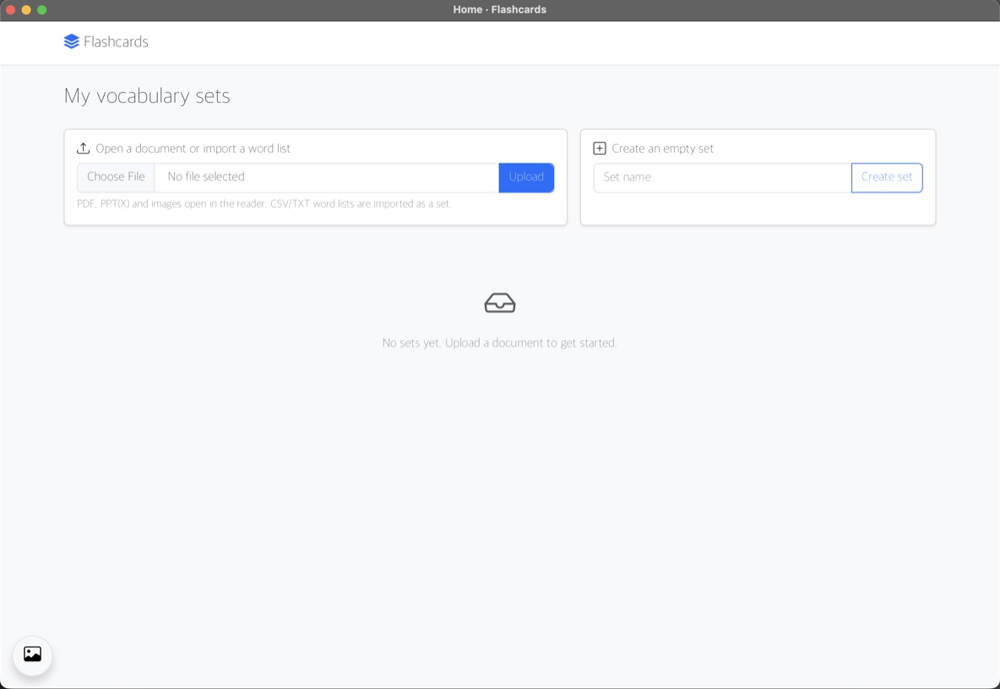 |

---

## 7. Peer review and improvements (상호 검토와 개선)

### 7.1 Feedback received and changes

| Reviewer | Feedback | Decision | What was changed | Reason |
|----------|----------|----------|------------------|--------|
| KIM YEONHO | Typing the definition of every word is slow; add automatic translation. | **Accepted** | The reader translates every word on a page as soon as it opens. On the Words page a blank meaning is translated. CSV/TXT lines without a meaning are translated on import. Meanings already saved in any set are reused, and every fetched translation is stored so a page is never translated twice. Meanings can still be typed or fixed with **Edit meaning**. | Typing meanings was the slowest step and the main reason a student would stop using the app. Reuse keeps the free quota. Editing keeps the user in control when a translation is wrong. |
| KIM TAESONG | When moving to the next slides, show which words were already saved. | **Accepted** | Every reader page checks the set's saved words. Saved words show a green **Saved** button and a highlighted box, and the header shows "n saved". The database refuses the same word twice in one set. | Lecture slides repeat the same terms on many pages. Without the mark, the student re-checks words they already have. The `UNIQUE` constraint makes duplicates impossible even if the page is out of date. |

Both changes are covered by tests (T11, T13) and were checked in the running app (M2).

### 7.2 Change history (변경 이력)

| When | Version | Change | Reason |
|------|---------|--------|--------|
| W09 (10/28) | Proposal | Console program, CSV file, words typed by hand | Initial plan (`ProjectReport.docx`) |
| W10 (11/04) | Design | Added OCR (Tesseract) and document reading | The real source of new words is the lecture slides, not the student's notes |
| W11 (11/11) | Desktop v1 | JavaFX GUI, PDF/PPT reading, Korean tokenising, MyMemory translation with retries, SQLite through the `sqlite3` command | Clicking a word on the slide is faster than typing it; SQLite saves after every answer without half-written files |
| W11 (11/16) | Desktop v1 | Mastery = **3 correct in a row**; typed answers; wrong cards re-queued in the same session; mastery rule moved into `Card.answered()` only; `Translator` interface | One correct answer can be a guess; AC1/AC2 need typed answers; the rule was duplicated in SQL and in undo; offline tests |
| W12 (11/17–18) | Web v2 | Rewritten as a **Spring Boot web app** (controllers / service / repository, JDBC driver, Thymeleaf + Bootstrap); JUnit 5 tests with Gradle | Clear layers, standard build with dependencies from Maven Central, tests of the whole HTTP flow, a better reader UI |
| W12 (11/18) | Web v2 | Peer review changes (§7.1), background picker, keyboard shortcuts | Feedback from classmates |
| W12 (11/18) | 1.0.0 | **Desktop package** (`Flashcards.app`, `.dmg`) with JavaFX WebView and its own Java runtime; configurable data folder | Can be started by double-click without a JDK, a terminal or a browser |

### 7.3 Problems discovered and how they were handled

| # | Problem | How it was found | Action |
|---|---------|------------------|--------|
| P1 | A fresh `git clone` could not run `./gradlew`: `.gitignore` ignored `*.jar`, so `gradle-wrapper.jar` was never committed | Clean-environment check | **Fixed:** `!gradle/wrapper/gradle-wrapper.jar` in `.gitignore`, jar committed |
| P2 | `build/` output was committed and changed on every build | `git status` after building | **Fixed:** removed from the repository (already in `.gitignore`) |
| P3 | Packaged app could not start ("Error creating bean flashcardRepository"): `data/` was a relative path, and a Mac app starts in `/` | First run of the desktop build | **Fixed:** `AppPaths`; the desktop app stores data in `~/Library/Application Support/Flashcards/` and creates the folder first |
| P4 | Scanned PDF pages (text inside an image) give no words | Manual test M8 | **Open:** OCR is used only for image uploads. Workaround: export the slide as PNG and upload it. Future: run OCR on PDF pages without text |
| P5 | Single words are translated without context: 주차 (in "11주차", week 11) → "PARKING", 계층 → "Social stratification", 최소 → "MIN" | Words page of the Java lecture set | **Mitigated:** meaning can be edited (E) or typed; future: translate the whole sentence and pick the word's meaning |
| P6 | MyMemory free tier: about 5,000 characters per day per IP | Service limits, checked in W11 | **Mitigated:** every translation stored and reused (a page is translated once), 3 retries, clear error; words can still be added by typing the meaning |
| P7 | The mastery rule existed in two places (SQL and undo) | Design review (W11) | **Fixed:** only `Card.answered()` |
| P8 | Development document described the old JavaFX/`sqlite3` design | Final review | **Fixed:** this document |
| P9 | Opening a page again sent all its unsaved words to MyMemory again (only saved cards were reused), wasting time and the free quota | Review after the final checks | **Fixed:** `translations` table; measured on page 9 of `13장_전송계층.pdf`: first view 3.4 s, second view 0.003 s, after a restart 0.012 s |

---

## 8. Execution guide (실행 방법)

### 8.1 Requirements

| | |
|---|---|
| Java | **JDK 25** (tested with Temurin 25.0.4). Gradle is not needed; `./gradlew` downloads it |
| Internet | First build (libraries from Maven Central) and translation (MyMemory, no key) |
| OCR (optional) | Tesseract: `brew install tesseract` on macOS. Korean/English data is already in `tessdata/` |
| Browser | Any modern browser, or the desktop app |

### 8.2 How to run

```bash
git clone https://github.com/yusufjonc07/flashcard-app.git
cd flashcard-app
./gradlew bootRun        # start, then open http://localhost:8080
./gradlew test           # run the 18 tests (no network needed)
./gradlew bootJar        # build/libs/flashcard-app-1.0.0.jar  → java -jar ... (run from the project folder)
./gradlew desktopApp     # build/desktop/Flashcards.app  (double-click)
./gradlew desktopDmg     # build/desktop/Flashcards-1.0.0.dmg  (installer)
```

Run commands from the project folder: `data/` (database, uploads) and `tessdata/` are
relative to it. The desktop app keeps its data in `~/Library/Application Support/Flashcards/`.
Other translation languages: `TRANSLATE_TARGET_LANGUAGE=uz ./gradlew bootRun`.

### 8.3 How to use each feature

1. **Quick demo:** on the home page, upload `data/sample-words.csv`, then press **Learn**.
2. **Read a lecture:** upload a PDF/PPT/PPTX/PNG/JPG. Use ←/→ to change pages. Hover a word
   (or ↑/↓) to see its meaning and press **Save** (or Enter). **W** shows or hides the list.
3. **Learn:** press **Learn** on a set. Turn on **Type answers**, type the meaning and press
   Enter. Or press Space to flip and ←/→ for Don't know / Know. H = hint, S = pronounce,
   E = edit meaning, Z = undo.
4. **Manage words:** **Words** shows the numbered list. Search at the top. Add a word on the
   left (leave the meaning blank to translate it). Delete with the bin icon.
5. **Create an empty set:** type a name under **Create an empty set** and add words by hand.
6. **Import a list:** upload a `.csv` (`word,meaning`) or `.txt` (one word per line,
   optionally `word<TAB>meaning`).

---

## 9. Limitations and future development (한계와 향후 계획)

| Not implemented / limitation | Reason | Future improvement |
|------------------------------|--------|--------------------|
| OCR for scanned PDF pages (P4) | OCR is slow (seconds per page); it was added only for image files first | Run OCR on PDF pages with no text layer, in the background |
| Context-aware translation (P5) | MyMemory translates one word at a time | Send the sentence and align the word, or let the user pick from several meanings |
| Clickable word boxes for PPT and images | Only PDFBox gives exact word positions | Use POI shape positions and Tesseract word boxes |
| Spaced repetition: mastered words never come back | Out of scope for the W09 requirements | Show mastered words again after 1, 3, 7… days |
| Accounts / sync between devices | The app is designed as a private, local tool | Optional export/import of the database file |
| Desktop package is built per OS and unsigned | `jpackage` builds only for the OS it runs on; signing needs an Apple developer account | Build on each OS (or in CI); sign and notarise for macOS |
